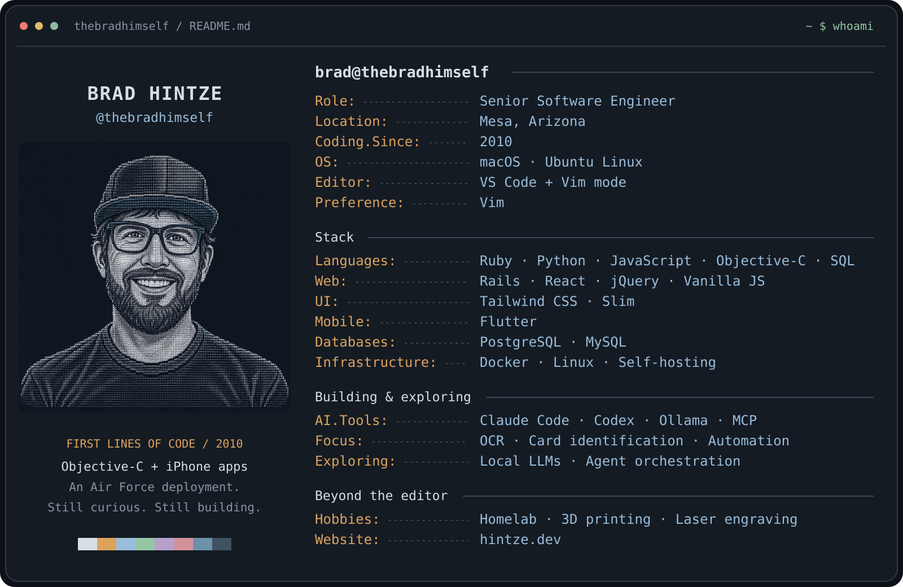

  

  <a href="https://hintze.dev">hintze.dev</a> &nbsp;·&nbsp; Mesa, Arizona &nbsp;·&nbsp; Building since 2010

## Hey, I'm Brad.

I'm a senior software engineer who builds web and mobile applications, automates repetitive work, and enjoys making complicated workflows easier to use.

I started coding in **2010 during an Air Force deployment**, teaching myself **Objective-C** so I could build iPhone apps. A few years later, I completed a **three-month full-stack Ruby on Rails bootcamp at DevPoint Labs**. These days, my work spans Rails, JavaScript, Python, Flutter, and practical applications of AI.

I like useful software, clear interfaces, and systems that are easier to maintain. I also have a habit of seeing a repetitive task and wondering how much of it I can automate.

## My toolkit

| Area | What I work with |
| :--- | :--- |
| **Languages** | Ruby, Python, JavaScript, Objective-C, SQL |
| **Web** | Ruby on Rails, React, jQuery, vanilla JavaScript |
| **UI** | Tailwind CSS, Slim |
| **Mobile** | Flutter; started with iPhone apps in Objective-C |
| **Databases** | PostgreSQL, MySQL |
| **Infrastructure** | Docker, Linux, self-hosted services |
| **AI tooling** | Claude Code, Codex, Ollama, MCP |
| **Environment** | macOS, Ubuntu Linux |
| **Editor** | VS Code with Vim mode. Vim is still my preferred editor. |

## Some of my background

### Nikola Motor Company

At **Nikola Motor Company**, I watched the company grow from **14 employees to more than 1,000**. One project I built for my team was a **work-from-home Slack bot**.

That kind of project is a good example of what I enjoy: taking something people deal with regularly and building a tool that makes it easier.

## What I'm building and exploring

- **OCR and card identification:** working on tools that turn card images into useful, structured metadata and make the review process easier.
- **AI-assisted development:** exploring local language models, specialist coding agents, and workflows for planning, implementation, review, and maintenance.
- **Music and social apps:** developing ideas around sharing albums, discovering music, and bringing friends into the experience.
- **Automation:** connecting tools and services so people spend less time on repetitive tasks.

## Away from the editor

Usually tinkering with a **homelab**, **Home Assistant**, a **3D printer**, or a **laser engraver**. I enjoy projects where software meets something you can actually use around the house.

## Let's connect

I'm interested in meeting other developers, comparing approaches, and collaborating on useful projects—especially developer tools, automation, and practical AI.

**[hintze.dev](https://hintze.dev)** · Mesa, Arizona
